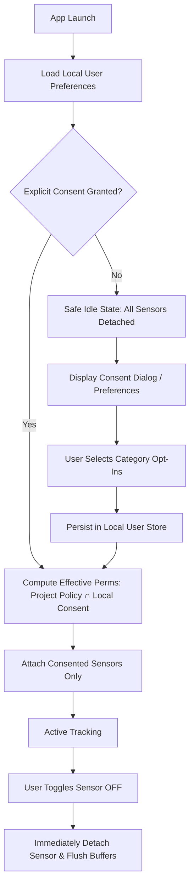
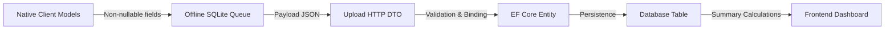
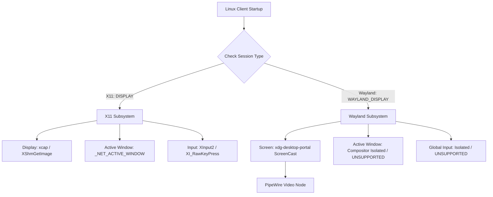

# Dosi-Tracker — Evidence-Based Consent & Capability Audit Specification

> **Document Class:** Security, Consent & Capability Architectural Specification
> **Status Date:** October 18, 2026
> **Auditor / Implementation Engineer:** Antigravity Pair Engineer
> **Supervisor:** PM / QA Operator
> **Repository:** `DosiBridge/Dosi-Tracker` (`main` branch)
> **Target Platforms:** Windows (Rust/Win32), macOS (Swift/Cocoa), Linux (Rust/X11/Wayland), Web Dashboard (Next.js), Backend (.NET 10/ABP)

---

## 1. Executive Summary & Audit Mandate

This audit provides an evidence-based investigation into data capture startup/shutdown call chains, user consent models, metric nullability obstacles, and platform capabilities across Dosi-Tracker.

### Critical Audit Invariants:
1. **Source Evidence vs Hypothesis**: Hypotheses are strictly separated from verified source lines. Every claim cites exact repository paths and line numbers.
2. **OS Permission $\neq$ User Consent**: An operating system permission grant (e.g., macOS TCC prompt or Windows low-level hook installation) is an OS capability grant, not current per-user application consent.
3. **Admin Policy $\neq$ User Consent**: Server-side project configuration (`Project.allow_screenshot`, `allow_keyboard`, etc.) represents workspace administration rules, not employee or contractor consent.
4. **No Metric Fabrication**: If a capability is denied, unsupported, or unconsented, the system must report `null` (unmeasured / unavailable). It must never fabricate zeros that simulate employee idleness.
5. **No Privilege Escalation Bypasses**: The Linux client must operate as an unprivileged desktop process without `root`, `sudo`, `/dev/input/event*` reading via `evdev`, or `uinput` synthetic devices.

---

## 2. Collection Call Chains: Windows & macOS (Source-Verified)

### 2.1 Windows Agent (`clients/windows`)

#### A. Startup Call Chain
```
main.rs:107-128: AppConfig::load() -> Tracker::new()
  └── tracking/mod.rs:65-73: Tracker::new()
        ├── input::spawn_listener(counter) [line 69]
        │     └── tracking/input.rs:694-703: Thread "input-hooks"
        │           └── tracking/input.rs:818-850: hooks::run()
        │                 ├── tracking/input.rs:752-765: hooks::install()
        │                 │     ├── SetWindowsHookExW(WH_KEYBOARD_LL, keyboard_proc, ...) [line 756]
        │                 │     └── SetWindowsHookExW(WH_MOUSE_LL, mouse_proc, ...) [line 757]
        │                 └── tracking/input.rs:846-850: GetMessageW message pump (WM_TIMER watchdog)
        └── usage::spawn_sampler(usage) [line 71]
              └── tracking/usage.rs:126-136: Thread "usage-sampler"
                    └── loop { record(now, active_window::current()); sleep(3s); } [lines 129-132]
```
- **Verified Source Reality**:
  - `Tracker::new()` in [main.rs:125](file:///d:/Github%20Projects/DosiBridge/Open%20Source/Dosi-Tracker/clients/windows/src/main.rs#L125) immediately invokes `input::spawn_listener` ([tracking/mod.rs:69](file:///d:/Github%20Projects/DosiBridge/Open%20Source/Dosi-Tracker/clients/windows/src/tracking/mod.rs#L69)) and `usage::spawn_sampler` ([tracking/mod.rs:71](file:///d:/Github%20Projects/DosiBridge/Open%20Source/Dosi-Tracker/clients/windows/src/tracking/mod.rs#L71)).
  - This occurs **at initial process startup**, before user authentication, before project selection, and before presenting any consent agreement.
  - In [tracking/input.rs:787-805](file:///d:/Github%20Projects/DosiBridge/Open%20Source/Dosi-Tracker/clients/windows/src/tracking/input.rs#L787-L805), `keyboard_proc` and `mouse_proc` immediately capture event timestamps into memory ring buffers (`EventLog`, lines 59–67).
  - In [tracking/usage.rs:123-125](file:///d:/Github%20Projects/DosiBridge/Open%20Source/Dosi-Tracker/clients/windows/src/tracking/usage.rs#L123-L125), the comment acknowledges: *"Start the background sampler. It only reads the foreground window, so it never needs to stop: while paused or signed out its samples simply fall outside any recorded block."* The thread executes `active_window::current()` every 3 seconds continuously.

#### B. Local Settings Defaults & Policy Handling
- **Configuration Defaults**:
  - [config.rs:47-59](file:///d:/Github%20Projects/DosiBridge/Open%20Source/Dosi-Tracker/clients/windows/src/config.rs#L47-L59): `CapturePermissions::default()` initializes:
    - `screenshot: true`
    - `webcam: false`
    - `keyboard: true`
    - `mouse: true`
    - `active_window: true`
    - `running_programs: true`
    - `blur_screenshots: false`
  - The local default is **opt-out**, not opt-in.
- **Session Policy Union**:
  - In [worker/session.rs:52-62](file:///d:/Github%20Projects/DosiBridge/Open%20Source/Dosi-Tracker/clients/windows/src/worker/session.rs#L52-L62), `session_for` calculates effective permissions by taking the logical AND of server project policy and local `config.toml` settings:
    `screenshot: project.allow_screenshot && local.screenshot`.
- **UI Policy Card**:
  - In [ui/settings.rs:320-370](file:///d:/Github%20Projects/DosiBridge/Open%20Source/Dosi-Tracker/clients/windows/src/ui/settings.rs#L320-L370) and [ui/settings.rs:373-406](file:///d:/Github%20Projects/DosiBridge/Open%20Source/Dosi-Tracker/clients/windows/src/ui/settings.rs#L373-L406), `policy_card` displays project policies with read-only pills (`On`/`Off`).
  - **Critical Gap**: There are **no interactive GUI controls** (checkboxes/switches) in the application window to let the user disable or opt out of specific capture types locally.

#### C. Control Transitions (Start / Pause / Resume / Stop / Quit / Lock / Break)
- **Start / Project Selection**:
  - In [worker.rs:1217-1220](file:///d:/Github%20Projects/DosiBridge/Open%20Source/Dosi-Tracker/clients/windows/src/worker.rs#L1217-L1220), `Command::SelectProject` starts block tracking.
- **Pause & Break**:
  - In [worker.rs:1221-1224](file:///d:/Github%20Projects/DosiBridge/Open%20Source/Dosi-Tracker/clients/windows/src/worker.rs#L1221-L1224) and [worker.rs:1640-1649](file:///d:/Github%20Projects/DosiBridge/Open%20Source/Dosi-Tracker/clients/windows/src/worker.rs#L1640-L1649), `pause()` records a `SavedPause` and ends the current block with `EndReason::Pause` or `EndReason::Break`.
  - **Hook Behavior on Pause**: `pause()` does **NOT** unhook `WH_KEYBOARD_LL` or `WH_MOUSE_LL`, and does **NOT** suspend the foreground window sampler.
  - As documented in [worker.rs:1654-1655](file:///d:/Github%20Projects/DosiBridge/Open%20Source/Dosi-Tracker/clients/windows/src/worker.rs#L1654-L1655): *"Not a second of the pause (or input made during it) is billed: a fresh block starts at the click."* The hooks continue logging events into the 125-minute circular memory buffer; they are merely not queried for block totals.
- **Lock / Sleep / Away**:
  - In [worker.rs:1035-1070](file:///d:/Github%20Projects/DosiBridge/Open%20Source/Dosi-Tracker/clients/windows/src/worker.rs#L1035-L1070) and [worker.rs:1180-1205](file:///d:/Github%20Projects/DosiBridge/Open%20Source/Dosi-Tracker/clients/windows/src/worker.rs#L1180-L1205), screen lock or idle thresholds cut the active block (`EndReason::Lock`, `EndReason::Idle`). Hooks remain active in background.
- **Quit / Shutdown**:
  - In [worker.rs:1740-1755](file:///d:/Github%20Projects/DosiBridge/Open%20Source/Dosi-Tracker/clients/windows/src/worker.rs#L1740-L1755), `Command::Shutdown` saves uncommitted blocks and flushes uploader queues.
  - The `input-hooks` thread exits only when the entire Windows process terminates (process tear-down).

---

### 2.2 macOS Agent (`clients/macos`)

#### A. Startup Call Chain
```
AppDelegate.swift:86: services.start()
  └── AgentServices.swift:58-63: AgentServices.start()
        ├── activeApp.start() [line 60]
        │     └── ActiveAppTracker.swift: NSWorkspace notification observer
        ├── inputMonitor.start(requestingPermission: false) [line 61]
        │     └── InputMonitor.swift:95-109: TapThread.start()
        │           └── InputMonitor.swift:204-233: TapThread.run()
        │                 ├── InputMonitor.swift:214-222: 10s Timer (check watchdog & retry)
        │                 └── InputMonitor.swift:240-275: attach()
        │                       └── CGEvent.tapCreate(.cgSessionEventTap, .headInsertEventTap, .listenOnly, ...)
        └── systemEvents.start() [line 62]
```
- **Verified Source Reality**:
  - In [AppDelegate.swift:86](file:///d:/Github%20Projects/DosiBridge/Open%20Source/Dosi-Tracker/clients/macos/Sources/DosiTracker/App/AppDelegate.swift#L86), `services.start()` is called directly inside `applicationDidFinishLaunching`.
  - In [AgentServices.swift:58-63](file:///d:/Github%20Projects/DosiBridge/Open%20Source/Dosi-Tracker/clients/macos/Sources/DosiTracker/App/AgentServices.swift#L58-L63), `start()` starts `activeApp`, `inputMonitor`, and `systemEvents`.
  - In [InputMonitor.swift:214-222](file:///d:/Github%20Projects/DosiBridge/Open%20Source/Dosi-Tracker/clients/macos/Sources/DosiTracker/System/InputMonitor.swift#L214-L222), a 10-second repeating timer (`InputMonitor.retryInterval`) calls `self.check()` indefinitely to recreate the tap and re-check permission.
  - In [InputMonitor.swift:46-47](file:///d:/Github%20Projects/DosiBridge/Open%20Source/Dosi-Tracker/clients/macos/Sources/DosiTracker/System/InputMonitor.swift#L46-L47), the architecture states: *"Start it once at launch and keep it running: a block reads only its own window of the log, so input while paused or signed out never counts."*
  - **Hook Lifetime**: The Quartz event tap runs continuously on thread `"com.dosibridge.tracker.input-tap"`.

#### B. Local Settings & Policy Handling
- **Local Defaults**:
  - In [MyProject.swift:151-152](file:///d:/Github%20Projects/DosiBridge/Open%20Source/Dosi-Tracker/clients/macos/Sources/DosiTrackerCore/Models/MyProject.swift#L151-L152): `CapturePermissions.localDefault` mirrors Windows:
    `screenshot: true, webcam: false, keyboard: true, mouse: true, activeWindow: true, runningPrograms: true`.
  - Defaults are opt-out.
- **UI Policy View**:
  - In [SettingsTab.swift:172-214](file:///d:/Github%20Projects/DosiBridge/Open%20Source/Dosi-Tracker/clients/macos/Sources/DosiTracker/UI/SettingsTab.swift#L172-L214), `policyCard` renders read-only `Pill(on ? "On" : "Off")`.
  - System permission rows ([SettingsTab.swift:120-142](file:///d:/Github%20Projects/DosiBridge/Open%20Source/Dosi-Tracker/clients/macos/Sources/DosiTracker/UI/SettingsTab.swift#L120-L142)) allow triggering macOS TCC prompts (`model.fix(permission)`), but provide no granular local application opt-in or refusal controls for project-mandated captures.

#### C. Control Transitions (Start / Pause / Resume / Stop / Quit)
- **Pause & Resume**:
  - In [TrackerWorker.swift:1262-1275](file:///d:/Github%20Projects/DosiBridge/Open%20Source/Dosi-Tracker/clients/macos/Sources/DosiTracker/Worker/TrackerWorker.swift#L1262-L1275), `pause()` reconciles the active block with reason `.pause` or `.onBreak` and persists the pause state.
  - In [TrackerWorker.swift:1279-1286](file:///d:/Github%20Projects/DosiBridge/Open%20Source/Dosi-Tracker/clients/macos/Sources/DosiTracker/Worker/TrackerWorker.swift#L1279-L1286), `resume()` starts a fresh block.
  - **Disabling vs Discarding**: Neither `pause()` nor `resume()` calls `inputMonitor.stop()` or `activeApp.stop()`. The event tap and workspace observer remain active.
  - In [AgentServices.swift:65-69](file:///d:/Github%20Projects/DosiBridge/Open%20Source/Dosi-Tracker/clients/macos/Sources/DosiTracker/App/AgentServices.swift#L65-L69), `AgentServices.stop()` exists, but a search across the entire macOS codebase confirms `services.stop()` is **never called anywhere** during pause, break, or stop.

---

## 3. Granular Local Opt-In Specification

To transform Dosi-Tracker from an administrative surveillance model into an evidence-based, consensual tool, desktop clients must adhere to a strict local opt-in contract.

### 3.1 Local Opt-In Contract Definition



#### A. Invariant 1: Default Safe (Opt-In, Not Opt-Out)
- On fresh installation or first launch, **all captures default to unconsented (`false`)**.
- No OS hooks (`WH_KEYBOARD_LL`, `WH_MOUSE_LL`, `CGEvent.tapCreate`), screen recording sessions, camera sessions, or window samplers may be spawned until the user explicitly completes the local consent configuration.
- Effective permissions must be calculated as:
  $$\text{Effective} = \text{ServerProjectPolicy} \cap \text{LocalUserConsent}$$
- If a project requires a capture category that the user has not consented to, the agent records that category as **refused by user consent** (`null`), never failing silently or forcibly capturing.

#### B. Invariant 2: Visible Status & Indicators
- The agent must display live capture status prominently in:
  1. The OS system tray / menu-bar icon (distinct visual state when actively recording screens or webcam).
  2. The desktop window header (e.g., *"Tracking: Screenshots (Blurred), Input Counts | Webcam: Disabled"*).
  3. Pre-capture indicators: For webcam captures, a brief visual HUD or banner notifies the user before the capture is taken.

#### C. Invariant 3: Immediate Withdrawal Semantics
- When a user withdraws consent for a category in local settings:
  1. **Immediate Hook Detachment**: If input counting consent is toggled off, `UnhookWindowsHookEx` or `CFMachPortInvalidate` must be called synchronously.
  2. **Timer Cancellation**: Window sampling intervals and screencast sessions must be terminated immediately.
  3. **Memory Flush**: Any uncommitted timestamps or window slices corresponding to the withdrawn category residing in memory ring buffers must be purged immediately.
  4. The current time block is split or completed with an explicit `endReason = "consent_change"`.

#### D. Invariant 4: Restart Persistence Semantics
- User consent preferences must be persisted in the local application preferences file (Windows: `%APPDATA%\DosiTracker\preferences.json`; macOS: `~/Library/Application Support/DosiTracker/preferences.json`; Linux: `~/.config/dosi-tracker/preferences.json`).
- If a server project updates its policy (e.g., administrator turns on `allow_webcam`), the agent **must not** automatically inherit the setting. The agent must pause tracking and display a notification informing the user that the project policy has changed, requesting explicit local consent before enabling the sensor.

#### E. Invariant 5: Offline Queued-Data Handling
- Data already committed to the local offline SQLite queue (`activities` table) was captured under active consent at that historical timestamp.
- However, to comply with privacy withdrawal rights:
  1. The local settings UI must provide an explicit **"Purge Offline Queue"** button, allowing the user to inspect and permanently delete pending blocks before they are synced to the backend.
  2. If the user revokes consent and requests queue erasure, the local database must execute:
     `DELETE FROM activities WHERE synced = 0;` followed by `VACUUM`.

---

### 3.2 Existing Implementation vs Gaps

| Capability / Flow | Existing Implementation | Identified Gap | Severity | Smallest Next Implementation Slice |
|---|---|---|:---:|---|
| **Input Hook Lifetime** | Hooks run continuously from launch to process exit. | Hooks run before login, before project selection, and during pause/break. | **HIGH** | Refactor `Tracker::new()` / `AgentServices.start()` to defer hook attachment until project tracking starts with explicit consent; detach on pause/stop. |
| **Foreground Window Sampler** | Runs infinite 3s loop from launch to exit. | Captures active window titles continuously even when paused or signed out. | **MEDIUM** | Guard `record()` loop with atomic `is_tracking_active` flag; sleep or stop thread when paused. |
| **Local Consent UI** | Settings tab displays read-only admin policy pills (`On`/`Off`). | User cannot toggle or refuse individual capture types locally in GUI. | **HIGH** | Add interactive toggle switches in `ui/settings.rs` and `SettingsTab.swift` binding to local `CapturePermissions`. |
| **Default Settings** | `CapturePermissions::default()` sets all to `true` (except webcam). | Opt-out by default rather than explicit user opt-in. | **HIGH** | Change local initial default to opt-in required (require user onboarding dialog on first sign-in). |
| **Offline Queue Purge** | Queue holds unsynced rows; no user deletion UI. | User cannot review or purge pending rows if consent is withdrawn offline. | **MEDIUM** | Add "Clear Pending Queue" button in settings with confirmation modal. |

---

## 4. End-to-End Metric Nullability & State Taxonomy

A foundational flaw in telemetry ingestion is the conflation of **measured zero** with **denied** or **unsupported**.

### 4.1 State Taxonomy

To preserve technical truth, telemetry fields must support five distinct semantic states:
1. **Measured Zero (`0`)**: Sensor was active, user consented, and zero events occurred during the interval (e.g., user was reading a document without typing).
2. **Denied (`null` + status `denied`)**: User or operating system explicitly refused permission to access the sensor (e.g., TCC Screen Recording denied, or local user toggled off screenshot consent).
3. **Unsupported (`null` + status `unsupported`)**: The operating system or display architecture lacks the capability to provide the metric without privilege escalation (e.g., Wayland unprivileged global input counting).
4. **Temporarily Unavailable (`null` + status `unavailable`)**: Sensor temporarily disconnected, dropped by OS watchdog, or waiting for permission handshake.
5. **Paused (`null` + status `paused`)**: Telemetry collection intentionally suspended by user break or manual pause.

---

### 4.2 End-to-End Obstacles Traced



#### Obstacle 1: Backend Domain Entity (`Activity.cs`)
- In [Activity.cs:19-22](file:///d:/Github%20Projects/DosiBridge/Open%20Source/Dosi-Tracker/backend/src/Dosi.Tracker.Domain/Activities/Activity.cs#L19-L22):
  ```csharp
  public int? Productivity { get; set; } // Nullable: null = not measured
  public int MouseClicks { get; set; }   // NON-NULLABLE: defaults to 0!
  public int KeyboardHits { get; set; }  // NON-NULLABLE: defaults to 0!
  ```
- **Consequence**: `Productivity` is nullable, but `MouseClicks` and `KeyboardHits` are non-nullable primitive integers. Any activity block saved to the database forces `KeyboardHits` and `MouseClicks` to an integer, converting missing/denied telemetry into `0`.

#### Obstacle 2: Upload Data Transfer Objects (`CreateActivityDto.cs` & `ActivityDto.cs`)
- In [CreateActivityDto.cs:40-43](file:///d:/Github%20Projects/DosiBridge/Open%20Source/Dosi-Tracker/backend/src/Dosi.Tracker.Application.Contracts/Activities/CreateActivityDto.cs#L40-L43):
  ```csharp
  [Range(0, int.MaxValue)]
  public int MouseClicks { get; set; }

  [Range(0, int.MaxValue)]
  public int KeyboardHits { get; set; }
  ```
- In [ActivityDto.cs:17-18](file:///d:/Github%20Projects/DosiBridge/Open%20Source/Dosi-Tracker/backend/src/Dosi.Tracker.Application.Contracts/Activities/ActivityDto.cs#L17-L18):
  ```csharp
  public int MouseClicks { get; set; }
  public int KeyboardHits { get; set; }
  ```
- **Consequence**: If a client sends `"keyboardHits": null` or omits the key in JSON, the .NET JSON deserializer binds `0`. The API contract literally cannot carry a null input count.

#### Obstacle 3: Native Client Models
- **Windows**: In [model.rs:157-158](file:///d:/Github%20Projects/DosiBridge/Open%20Source/Dosi-Tracker/clients/windows/src/model.rs#L157-L158):
  ```rust
  pub mouse_clicks: u64,
  pub keyboard_hits: u64,
  ```
  `mouse_clicks` and `keyboard_hits` are primitive `u64`, not `Option<u64>`. They serialize to JSON as `"mouseClicks": 0, "keyboardHits": 0`.
- **macOS**: In [ActivityPayload.swift:197-198](file:///d:/Github%20Projects/DosiBridge/Open%20Source/Dosi-Tracker/clients/macos/Sources/DosiTrackerCore/Models/ActivityPayload.swift#L197-L198):
  ```swift
  public var mouseClicks: Int
  public var keyboardHits: Int
  ```
  Primitive `Int` defaulting to `0` ([ActivityPayload.swift:247-248](file:///d:/Github%20Projects/DosiBridge/Open%20Source/Dosi-Tracker/clients/macos/Sources/DosiTrackerCore/Models/ActivityPayload.swift#L247-L248)).

#### Obstacle 4: Window Telemetry Empty Array Ambiguity
- In `Activity.cs:24-26`, `ActiveWindowsJson`, `RunningProgramsJson`, and `TimelineJson` default to `"[]"`.
- If active window capture is denied or unsupported, clients submit `[]`.
- In reports and dashboard views, an empty array `"[]"` is indistinguishable from "no active windows had focus" vs "window capture capability was denied or unsupported".

#### Obstacle 5: Frontend Ingestion Clamping
- In [live-dataset.ts:444](file:///d:/Github%20Projects/DosiBridge/Open%20Source/Dosi-Tracker/frontend/src/lib/live-dataset.ts#L444):
  `keyboardHits: Math.max(0, Math.round(num(dto.keyboardHits)))`
- In [work-report.ts:1259](file:///d:/Github%20Projects/DosiBridge/Open%20Source/Dosi-Tracker/frontend/src/lib/work-report.ts#L1259):
  `keys: nonNegative(activity.keyboardHits)`
- The dashboard treats `0` as a legitimate numeric tally, pulling down team averages.

---

### 4.3 Compatibility & Migration Plan

To fix these obstacles without breaking legacy clients:
1. **EF Core Migration**:
   - Update `Activity.cs`:
     ```csharp
     public int? MouseClicks { get; set; }
     public int? KeyboardHits { get; set; }
     public string? ActiveWindowsJson { get; set; } // null when unsupported/denied
     ```
   - Generate EF Core migration altering columns `MouseClicks` and `KeyboardHits` to nullable `INTEGER NULL`.
2. **DTO Backward Compatibility**:
   - Update `CreateActivityDto.cs` and `ActivityDto.cs` to `public int? MouseClicks { get; set; }` and `public int? KeyboardHits { get; set; }`.
   - Existing clients sending `0` continue to be recorded as `0`.
   - Updated clients with denied or unsupported capabilities omit the field or send `null`, which is preserved as `null` through persistence and API responses.
3. **Frontend Presentation**:
   - Update `types.ts` and `work-report.ts`:
     When `keyboardHits === null` or `mouseClicks === null`, render "—" or "Not Measured" instead of "0", excluding the block from input-rate calculations.

---

## 5. Linux X11 / Wayland Capability & Consent Matrix

Linux desktop environments are split between legacy X11 and modern Wayland compositors (GNOME Mutter, KDE KWin, wlroots/Sway).

### 5.1 Architecture & Display Server Breakdown



#### A. Display & Screen Capture
- **X11**:
  - `XGetImage` or `XShmGetImage` via standard X11 protocol. Unconfined user processes can capture any screen without interactive prompts.
- **Wayland**:
  - Direct root window capture is **strictly prohibited** by the Wayland architecture.
  - Standard implementation: `org.freedesktop.portal.ScreenCast` via D-Bus and PipeWire.
  - **Portal Workflow & User Consent**:
    1. Agent calls `org.freedesktop.portal.ScreenCast.CreateSession(options)`.
    2. Agent calls `SelectSources(session_handle, { types: 1, multiple: false })`.
    3. The desktop compositor presents an **OS system dialog** requiring the user to explicitly select the display to share or click "Cancel".
    4. **Refusal Handling**: If the user cancels, the portal returns error response `1` (User Cancelled). The agent must catch this signal, record screenshot status as `denied`, and must **not** loop in a tight retry loop.
    5. **Stream Establishment**: If approved, `Start(session_handle)` returns PipeWire node IDs. The agent connects to `libpipewire`, negotiates buffers, and captures frames.
    6. **Session Termination**: The user or compositor can terminate the stream at any time via the compositor HUD; the agent receives the `Closed` signal on `org.freedesktop.portal.Session`.

#### B. Global Input Counting (Keyboard & Mouse)
- **X11**:
  - Handled via `XInput2` (`XISelectEvents` with `XI_RawKeyPress`, `XI_RawButtonPress`) or `XRecord`.
- **Wayland**:
  - **Compositor Isolation**: Wayland compositors isolate input events to the focused surface. There is **no standard unprivileged global input monitoring portal** in freedesktop specifications.
  - `org.freedesktop.portal.RemoteDesktop` exists for input injection/remote assistance, not passive background listening.
  - `libei` / `libeis` (Emulated Input System) is designed for input emulation, not eavesdropping.
  - **Evdev Prohibition**:
    - Raw `/dev/input/event*` nodes provide low-level kernel input events.
    - These nodes are owned by `root:input` with `0660` permissions.
    - An unprivileged process cannot read them without running as `root`, `sudo`, or adding the desktop user to the `input` group.
    - Requiring `sudo`, SUID binaries, or membership in the `input` group turns the client into a system-wide hardware keylogger capable of intercepting root passwords and other users' sessions.
    - **Architecture Decision**: The Linux agent **strictly prohibits** root, sudo, evdev, or uinput escalation. On Wayland, global input counting is classified as **UNSUPPORTED**, and `keyboard_hits` / `mouse_clicks` must be reported honestly as `null`.

#### C. Active Window & Application Tracking
- **X11**:
  - Root window property `_NET_ACTIVE_WINDOW` provides the focused XID.
  - Window title: `_NET_WM_NAME` or `WM_NAME`.
  - Process name: `_NET_WM_PID` inspected against `/proc/<pid>/cmdline`.
- **Wayland**:
  - Window hierarchy is private to the compositor.
  - GNOME Shell (Mutter) and KDE (KWin) do not expose a public unprivileged portal for active window title tracking.
  - wlroots compositors provide `wlr-foreign-toplevel-management-unstable-v1`, but this is not universal across GNOME/KDE.
  - `/proc` scanning can list all processes belonging to the user, but cannot identify which application is in the foreground.
  - **Architecture Decision**: On Wayland, active window title tracking is classified as **UNSUPPORTED** unless a recognized compositor-specific extension is explicitly authorized by the user.

---

### 5.2 Truthful Linux Capability & Consent Matrix

| Telemetry Type | X11 (Unconfined) | Wayland (GNOME / KDE) | Permission / Mechanism | Consent Mechanism | Unsupported / Refusal Behavior |
|---|---|---|---|---|---|
| **Screen Capture** | Supported | Supported via Portal | X11: `XShmGetImage`<br>Wayland: `xdg-desktop-portal.ScreenCast` + PipeWire | Wayland: Interactive OS modal dialog on session create | If cancelled/closed: record `null`, status `denied`; no crash or retry storm. |
| **Keyboard Hits** | Supported | **UNSUPPORTED** | X11: `XInput2` (`XI_RawKeyPress`)<br>Wayland: None (isolated) | X11: Local application opt-in<br>Wayland: N/A | Wayland: Record `null` (`unsupported`). Strictly no `sudo`/`evdev`. |
| **Mouse Clicks** | Supported | **UNSUPPORTED** | X11: `XInput2` (`XI_RawButtonPress`)<br>Wayland: None (isolated) | X11: Local application opt-in<br>Wayland: N/A | Wayland: Record `null` (`unsupported`). Strictly no `sudo`/`evdev`. |
| **Active Window Title** | Supported | **UNSUPPORTED** | X11: `_NET_ACTIVE_WINDOW` + `_NET_WM_NAME`<br>Wayland: Private to compositor | Local application opt-in | Wayland: Record `null` (`unsupported`). Do not fake active window. |
| **Running Programs** | Supported | Partial (Process list) | `/proc/[pid]/comm` and `/proc/[pid]/cmdline` scanning | Local application opt-in | User processes only. Background window titles never collected. |
| **Webcam Photo** | Supported | Supported | `v4l2` (`/dev/video*`) / GStreamer / PipeWire camera | Local application opt-in + camera indicator | If device inaccessible or denied: record `null`, status `denied`. |

---

## 6. Smallest Next Implementation Slice Proposal

To make immediate, bounded architectural progress without embarking on an unconstrained multi-platform rewrite, the **smallest next implementation slice** is:

### Phase 2 Implementation Slice: Backend & Schema Nullability Alignment
1. **Target**: Backend domain entities and DTO contracts.
2. **Changes**:
   - Modify `Activity.cs`: change `MouseClicks` and `KeyboardHits` to `int?`.
   - Modify `CreateActivityDto.cs` and `ActivityDto.cs`: change `MouseClicks` and `KeyboardHits` to `int?`.
   - Update `ActivityAppService.cs`: pass nullable metrics directly through without zero-defaulting.
   - Add EF Core migration updating database columns to nullable.
   - Update `live-dataset.ts` and `work-report.ts` in frontend to handle `null` counts cleanly.
3. **Evidence Gate**:
   - Run EF Core test harness: verify that both legacy blocks (with numeric 0) and modern blocks (with explicit `null`) are persisted and retrieved correctly.
   - Run frontend `validate`: ensure typecheck, lint, and all 1,965 tests pass.
4. **Why this slice first**:
   - It eliminates the structural obstacle that currently forces clients to fabricate zeros. Once the backend and frontend can honestly carry `null`, desktop clients (Windows, macOS, and future Linux) can safely report unmeasured, denied, and unsupported states.
