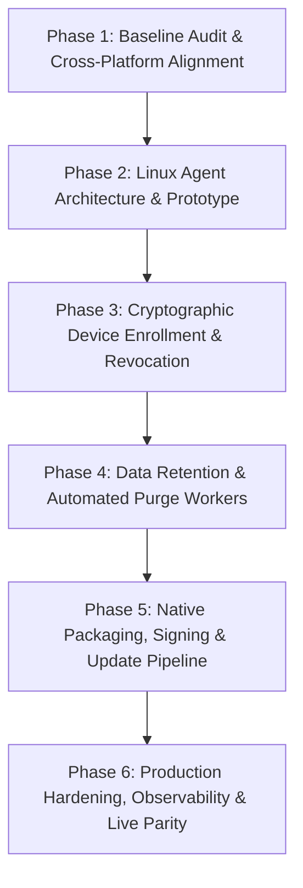

# Dosi-Tracker — PM Execution Plan & Multi-Phase Roadmap

> **Document Class:** Product Management Execution Plan & System Engineering Architecture  
> **Target Release:** Production Multi-Tenant Activity & Time-Tracking Platform  
> **Platforms:** Backend (.NET 10 / ABP / PostgreSQL), Web Dashboard (Next.js 16 / React 19 / Tailwind), Native Desktop Clients (Windows Rust, macOS Swift, Linux Rust/Tauri/Daemon)  
> **Audit & Baseline Date:** October 2026 (Local Baseline Verification Complete)

---

## 1. Executive Summary & Philosophy

Dosi-Tracker is an open-source, multi-tenant team activity and time-tracking system designed to provide transparent, consensual, and privacy-first visibility into work activity. The system consists of:
1. **Cloud Backend**: .NET 10, ABP Framework, Entity Framework Core, PostgreSQL, OpenIddict (OIDC), and ABP Blob Storing (S3/Cloudflare R2/Database).
2. **Web Dashboard**: Next.js 16 (App Router, Turbopack, Tailwind CSS, Recharts) supporting SaaS tenant workflows, manager monitors, real-time analytics, reporting, and platform host administration.
3. **Native Desktop Clients**:
   - **Windows Client**: Native Rust background agent with egui UI, Win32 hooks (`rdev`), `xcap` GDI/DXGI display capture, MediaFoundation webcam capture, DPAPI credential encryption, and local SQLite offline queue.
   - **macOS Client**: Swift 5.9 native menu-bar application leveraging `ScreenCaptureKit` (`SCScreenshotManager`), `AVFoundation`, `Accessibility` / `CGEvent` APIs, Keychain storage, and SQLite3 offline queue.
   - **Linux Client**: Explicit architectural greenfield addressing X11 and Wayland display servers (`xdg-desktop-portal` PipeWire screencast, evdev/uinput or compositor idle protocols).

### Core Privacy & Compliance Invariants
- **Consent-First Architecture**: No stealth installation, background evasion, concealed recording, or unauthorized credential sniffing.
- **Input Counts Only**: The agent captures monotonic keyboard and mouse event tallies. Raw keystrokes, clipboard buffers, and keystroke timing cadences are **strictly excluded** from data capture and network serialization.
- **Granular Project Policy**: Capture features (screenshots, webcam, active window, running programs) are configured per-project on the server and enforced on both client and server.
- **Opt-In Webcam & Defensible Capture**: Webcam capture defaults to `false`. Screenshots support server-side blur policies and thumbnail-first previews.
- **Testing Guardrail**: Under no circumstances are live workstation screens, webcams, or employee activities captured during automated testing or QA. All test suites operate strictly on synthetic fixtures, in-memory mocks, and simulated inputs.

---

## 2. Multi-Phase Implementation Roadmap

### Phase 1: Baseline Audit, Toolchain Verification & Foundational Cross-Platform Contract (Completed in Current Sprint)
- **Scope**:
  - Full codebase audit across backend, frontend, desktop clients, CI, and test suites.
  - Toolchain verification (.NET 10, Node 24, Rust 1.97, Swift availability check).
  - Identification of all platform gaps, stubbed endpoints, and security/privacy debts.
  - Implement the foundational cross-platform contract gap: enable `"linux"` platform normalization in backend (`ActivityConsts.Platforms`), frontend contract (`api-contract.ts`), device monitors (`devices.ts`), and analytics charts (`analytics-charts.tsx`).
- **Gating Evidence**: All 820 backend tests green; all 1,955 frontend vitest tests green; frontend architecture tests green; Next.js production build green; Windows client 345 cargo tests green.

### Phase 2: Linux Desktop Agent Core & Wayland/X11 Ingestion
- **Objective**: Establish the official `clients/linux` component without making false claims about Windows code cross-compiling on Linux.
- **Deliverables**:
  1. Create `clients/linux` Rust crate sharing domain models with `clients/windows`.
  2. Implement display server detection: detect X11 (`DISPLAY`) vs Wayland (`WAYLAND_DISPLAY`).
  3. X11 Engine: `XRecord` or `XTest` for monotonic key/mouse counters; `XShmGetImage` or `xcap` for display snapshot; `_NET_ACTIVE_WINDOW` for active window.
  4. Wayland Engine: `org.freedesktop.portal.ScreenCast` via D-Bus and PipeWire for consent-based screen capture. Implement user-permission prompt handling.
  5. Fallback & Graceful Degradation: When Wayland compositor forbids global input tapping without root, report zero counts with explicit degradation status rather than crashing or escalating privileges.
  6. SQLite offline queue identical to Windows/macOS with idempotent client activity ID and poison-row parking (`synced = 2`).

### Phase 3: Cryptographic Device Enrollment, Mutual Session Verification & Revocation
- **Objective**: Move beyond self-reported random `DeviceId` GUIDs to a cryptographic device authorization lifecycle.
- **Deliverables**:
  1. Device Key Generation: Desktop agent generates an Ed25519 or ECDSA keypair stored in OS secure vault (Windows DPAPI, macOS Keychain, Linux Secret Service API / libsecret).
  2. Device Registration API: `POST /api/app/devices/register` associating public key, hardware fingerprint, and user approval.
  3. Device Revocation API: `POST /api/app/devices/{id}/revoke` allowing workspace owners/admins and users to revoke any authorized agent install.
  4. Middleware / Filter: Ingestion endpoints (`/api/app/activity`, `/api/app/presence/heartbeat`) verify device active status; revoked devices receive `403 Tracker:DeviceRevoked` causing agent to pause, purge local auth tokens, and require re-authentication.

### Phase 4: Automated Data Retention, Pruning Workers & Storage Optimization
- **Objective**: Automate data retention policies across PostgreSQL tables and S3/R2 blob containers.
- **Deliverables**:
  1. Background Worker (`DataRetentionWorker` in ABP): Periodic sweep honoring workspace retention settings (e.g. 30, 90, 180, 365 days).
  2. Screenshot Deletion: Purge aged screenshot blobs from object storage and cascade delete `Screenshot` rows.
  3. Activity Compaction: Roll up expired minute-bucket activity into summarized hourly/daily aggregates before archival.
  4. GDPR Erasure Endpoint: Allow user or administrator-initiated erasure of personal biometric/screenshot artifacts.

### Phase 5: Native Packaging, Signed Distribution & Secure Auto-Update Strategy
- **Objective**: Production-grade installers, signed executables, and secure update manifests for all three platforms.
- **Deliverables**:
  1. **Windows**: Authenticode code-signing configuration for NSIS installer (`dosi-tracker-setup.exe`) to eliminate SmartScreen warnings. Integrate secure update manifest checker via GitHub Releases or private feed.
  2. **macOS**: Integrate Apple Developer ID Application certificate signing, Hardened Runtime entitlements (`com.apple.security.device.camera`, `com.apple.security.files.user-selected.read-write`), and Apple Notarization (`xcrun notarytool submit` + `stapler`). Universal binary (arm64 + x86_64) distribution.
  3. **Linux**: Package as AppImage (portable across distros), `.deb` for Debian/Ubuntu, and `.rpm` for Fedora/RHEL. Provide Flatpak manifest for sandbox compliance.

### Phase 6: Production Infrastructure, Observability & Multi-Region Parity
- **Objective**: Production hosting, automated DR drills, and end-to-end monitoring.
- **Deliverables**:
  1. OpenTelemetry metrics and distributed tracing in HttpApi.Host.
  2. Prometheus metrics exporter for ingest rate, queue latency, and error breakdown.
  3. PostgreSQL backup verification drill (`pg_dump` restore validation runbook).
  4. CDN and presigned URL streaming for screenshot assets.

---

## 3. Platform & Architectural Constraints

| Topic | Constraint | Architecture Decision |
|---|---|---|
| **OS Credentials** | Plaintext tokens or passwords in files are prohibited | Windows: DPAPI `CryptProtectData`. macOS: Keychain Services. Linux: Secret Service API (`libsecret`) / encrypted SQLite key. |
| **Keystrokes** | Privacy regulations (GDPR, CCPA) strictly prohibit key logging | Agents record only atomic integer increments (`keyboard_events += 1`). No virtual key codes or ASCII values are logged or transmitted. |
| **Webcam Security** | Biometric and camera capture requires explicit consent | Webcam captures are stored as discrete JPGs tagged `kind: webcam`. Project settings default to disabled; disabling on server hides historical webcam items from unauthorized roles. |
| **macOS Permissions** | macOS enforces sandbox and TCC privacy controls | Agent handles missing permissions gracefully: screen capture omitted if Screen Recording denied; input counts zeroed if Accessibility denied; camera frame omitted if Camera denied. |
| **Linux Wayland** | Compositor security prevents silent background screen grabs | Ingestion engine requires `xdg-desktop-portal` user consent session. If denied or unavailable, agent logs refusal and tracks time/window without failing. |
| **Offline Idempotency** | Network partitions cause client queue retransmissions | `ClientActivityId` (UUIDv7 or UUIDv4) unique constraint on `(WorkspaceId, ClientActivityId)`. Database uniqueness races return the existing row with 200 OK. |

---

## 4. Verification & Testing Standards

1. **Backend**:
   - Unit tests: Domain invariants and normalizers (`Domain.Tests`).
   - Integration tests: In-memory SQLite with full ABP Unit of Work, data filters, and tenant isolation (`EntityFrameworkCore.Tests`).
   - Host route tests: HTTP controller status codes and rate limiting (`HttpApi.Host.Tests`).
   - Acceptance tests: Multi-step BDD scenarios (`Acceptance.Tests`).
2. **Frontend**:
   - Unit & Property tests: Business math and data transformations via Vitest and `fast-check`.
   - Component & a11y tests: React Testing Library with `jest-axe` for WCAG 2.1 AA compliance.
   - Architectural gate: `dependency-cruiser` checking layering rules and forbidden circular imports.
   - Bundle budget: Size limit checks enforced by `bundle-budget.mjs`.
3. **Windows Agent**:
   - Crate tests: In-memory SQLite queue FIFO order, upload backoff doubling, poison row parking, session state machines, time math across DST/midnight boundaries.
4. **macOS Agent**:
   - Swift Package tests: `DosiTrackerCoreTests` testing models, queue, date parsing, skew calculations, and upload retry logic.
