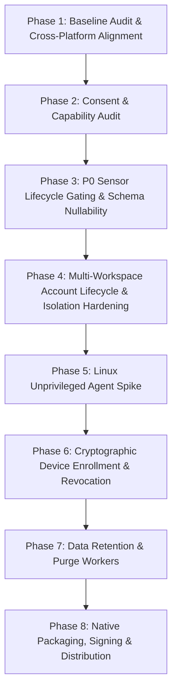

# Dosi-Tracker — PM Execution Plan & Multi-Phase Roadmap

> **Document Class:** Product Management Execution Plan & System Engineering Architecture  
> **Target Release:** Production Multi-Tenant Activity & Time-Tracking Platform  
> **Platforms:** Backend (.NET 10 / ABP / PostgreSQL), Web Dashboard (Next.js 16 / React 19 / Tailwind), Native Desktop Clients (Windows Rust, macOS Swift, Linux Rust/Tauri/Daemon)  
> **Audit & Baseline Date:** October 2026 (Local Baseline Verification Complete)

---

## 1. Executive Summary & Philosophy

Dosi-Tracker is an open-source, multi-tenant team activity and time-tracking system designed to provide transparent, consensual, and privacy-first visibility into work activity. The system consists of:
1. **Cloud Backend**: .NET 10, ABP Framework, Entity Framework Core, PostgreSQL, OpenIddict (OIDC), and ABP Blob Storing (S3/Cloudflare R2/Database).
   - *Test Evidence Distinction*: Backend services are validated using concrete Entity Framework Core SQLite in-memory test host fixtures (`Dosi.Tracker.EntityFrameworkCore.Tests`) and simulated authentication principals. This validates schema constraints, business rules, and unit-of-work logic, but does not represent a live multi-node production deployment.
2. **Web Dashboard**: Next.js 16 (App Router, Turbopack, Tailwind CSS, Recharts) supporting SaaS tenant workflows, manager monitors, real-time analytics, reporting, and platform host administration.
   - *Test Evidence Distinction*: Dashboard modules are validated via component and integration tests in Node.js / jsdom using `@testing-library/react` and synthetic memory datasets.
   - *Accessibility Distinction*: Automated axe checks in jsdom and machine-contrast calculations verify programmatic invariants; they do **not** prove full WCAG 2.1 AA/AAA compliance (real-browser keyboard traps, screen reader verification, zoom reflow, and manual assistive audits remain open).
3. **Native Desktop Clients**:
   - **Windows Client**: Native Rust background agent with egui UI, Win32 hooks (`rdev`), `xcap` GDI/DXGI display capture, MediaFoundation webcam capture, DPAPI credential encryption, and local SQLite offline queue.
     - *Test Evidence Distinction*: 345 cargo tests verify SQLite queue FIFO semantics, backoff math, poison row parking, and synthetic state machines. Native interactive screen grabs, hardware keystroke interrupts, and Win32 focus transitions are implemented in source but are **not** verified interactively during automated unit testing. Source presence is **not** proof of complete implementation; packaging, signing, and native runtime execution remain open.
   - **macOS Client**: Swift 5.9 native menu-bar application leveraging `ScreenCaptureKit` (`SCScreenshotManager`), `AVFoundation`, `Accessibility` / `CGEvent` APIs, Keychain storage, and SQLite3 offline queue.
     - *Test Evidence Distinction*: Swift source code is present in `clients/macos/`. Source presence is **not** complete runtime validation; CI workflow configuration files are not proof tests ran. Native compilation, TCC permissions, and runtime validation remain outstanding on this host.
   - **Linux Client**: Explicit architectural greenfield addressing X11 and Wayland display servers (`xdg-desktop-portal` PipeWire screencast, user-space input/window metrics, and graceful degradation reporting).

### Core Privacy & Compliance Invariants
- **Consent-First Architecture & Visible User Controls**:
  - No stealth installation, background evasion, concealed recording, or unauthorized credential sniffing.
  - Data capture requires **per-user opt-in and visible local controls** (system tray / notifications / pause / stop), not merely an administrative project setting on the server.
- **No Privilege Escalation by Default**:
  - The client must never require root, `sudo`, direct `/dev/input/event*` reading via `evdev`, or `uinput` privilege escalation as a default operational mode.
- **No Input Synthesis**:
  - The desktop client is strictly an observer. It must never synthesize mouse movements, inject keystrokes, or simulate fake user presence.
- **Input Counts Only (Data Minimization vs Legal Compliance)**:
  - The agent captures monotonic keyboard and mouse event tallies. Raw keystrokes, clipboard buffers, keycodes, and inter-keystroke timing cadences are **strictly excluded** from data capture and serialization.
  - *Legal Precision*: Monotonic counting is a privacy-conscious technical safeguard, but does **not** by itself establish legal compliance with GDPR, CCPA, or workplace privacy regulations. Compliance requires lawful basis, employee notice, data processing agreements, purpose limitation, and proportional monitoring policies.
- **No Default Hardware Fingerprinting**:
  - Desktop installations are identified by a generated UUIDv4 `DeviceId`. The agent does not collect MAC addresses, BIOS serial numbers, CPU serials, or persistent hardware identifiers by default.
- **Graceful Degradation vs Fabricated Metrics**:
  - On Wayland or restricted environments where global input sniffing or active window tracking is unsupported without root, the client and server must report the metric as **explicitly unavailable** (`null`).
  - The agent must never promise active-window data without an authorized supported interface, and must never emit fabricated zero counts that create a false record of user idleness.
- **Granular Project Policy & Opt-In Webcam**:
  - Capture features (screenshots, webcam, active window, running programs) are configured per-project on the server and enforced on both client and server.
  - Webcam capture defaults to `false`. When enabled, captures require local user consent, visible indicator, and capture only discrete downscaled JPEGs once per interval.
- **Testing Guardrail**:
  - Under no circumstances are live workstation screens, webcams, or employee activities captured during automated testing or QA. All test suites operate strictly on synthetic fixtures, in-memory mocks, and simulated inputs.

---

## 2. Multi-Phase Implementation Roadmap

### Phase 1: Baseline Audit, Toolchain Verification & Cross-Platform Contract (Completed in Prior Sprint)
- **Scope**:
  - Full codebase audit across backend, frontend, desktop clients, CI, and test suites.
  - Identification of platform gaps, stubbed endpoints, and security/privacy debts.
  - Implement cross-platform `"linux"` platform normalization across backend (`ActivityConsts.Platforms`) and frontend (`api-contract.ts`, `types.ts`, `devices.ts`, `analytics.ts`, `report-math.ts`, `live-dataset.ts`, `analytics-charts.tsx`).
  - Resolve accessibility contrast regression on Linux platform color (`#cb6e17` yielding $\ge 3:1$ on light `#ffffff` and dark `#1a2226` card tokens).
  - Add automated regression tests deriving card tokens dynamically from `globals.css` with guards against stale literals, missing tokens, and print overrides.
  - Explicitly prefix contrast tests with `a11y:` so `npm run test:a11y` executes them.
  - Add dedicated Linux `platformMix` regression test in `analytics.test.ts`.
  - Split backend Linux test cases into independent `[Fact]` methods (`Create_Should_Accept_And_Store_Linux_Platform` and `Heartbeat_Should_Accept_And_Store_Linux_Platform`) executed by concrete EF Core host harness (`EfCoreActivityAppServiceTests` and `EfCorePresenceAppServiceTests`).
- **Gating Evidence**:
  - **Operator Independently Verified (Commit `59403f8`)**: Clean working tree and commit `59403f8`; `npm run test:a11y` passed (53 passed, 1912 skipped, all 9 analytics-charts token/contrast tests included, exit 0); `npm run validate` passed (1,965 passed in 92 files, typecheck exit 0, lint 0 errors / 3 warnings, architecture 12 passed with no dependency violations, exit 0). Synthetic/jsdom only, no native collection.
  - **Worker-Reported Suite Results**: Full backend 823 tests (60 Domain, 116 Host, 166 Application, 466 EntityFrameworkCore, 15 Acceptance) and Windows client 345 cargo tests remain worker-reported.

### Phase 2: Bounded Consent & Capability Audit (Completed in Current Sprint)
- **Objective**: Establish an evidence-based consent and capability audit and implementation-ready specification before implementing Linux collection or device enrollment redesign.
- **Completed Artifact**: Dedicated specification [docs/CONSENT_CAPABILITY_AUDIT.md](file:///d:/Github%20Projects/DosiBridge/Open%20Source/Dosi-Tracker/docs/CONSENT_CAPABILITY_AUDIT.md).
- **Core Findings & Deliverables**:
  1. **Source-Verified Call Chains**: Traced startup/shutdown for Windows (`main.rs:125`, `tracking/mod.rs:65-73`, `input.rs:694-850`, `usage.rs:126-136`) and macOS (`AppDelegate.swift:86`, `AgentServices.swift:58-63`, `InputMonitor.swift:95-260`). Proved that hooks start at launch prior to local opt-in, and that pause/stop merely stops querying ring buffers rather than detaching OS hooks or halting background sampling.
  2. **Granular Local Opt-In Contract**: Defined default-safe opt-in contract for screenshots, webcam, input counts, active window, and running apps, with visible tray status, synchronous hook detachment on withdrawal, local preference persistence, and offline queue purge capability.
  3. **End-to-End Metric Nullability Obstacles**: Identified non-nullable `int` fields in backend entity (`Activity.cs:20-21`) and DTOs (`CreateActivityDto.cs:40-43`, `ActivityDto.cs:17-18`), non-nullable client models (`model.rs:157-158`, `ActivityPayload.swift:197-198`), and frontend clamping (`live-dataset.ts:444`, `work-report.ts:1259`). Documented migration path to honest `null` states separating measured zero, denied, unsupported, temporarily unavailable, and paused.
  4. **Truthful Linux X11/Wayland Matrix**: Documented `xdg-desktop-portal` ScreenCast session cancellation and close signals, compositor client isolation rendering Wayland global input and window titles unsupported, and strict prohibition on root, `sudo`, `evdev`, and `uinput` bypasses.

### Phase 3: P0 Privacy Sensor Lifecycle Gating & Schema Nullability Alignment
- **Objective**: Eliminate background sensor sampling during pause/inactive states, implement active tracking gating across Windows tracking subsystems, and align backend/frontend nullability schemas.
- **Deliverables**:
  1. **Active Tracking Gating in `UsageRecorder` & `InputCounter`**:
     - Implement atomic active-tracking flag in `UsageRecorder` and `InputCounter`.
     - When tracking is inactive, paused, away, locked, or signed out, foreground window sampling and input event logging are deactivated; samples are dropped immediately without memory buffering.
     - Wire `Machine::set_tracking_active` through `Tracker` and `Worker` lifecycle state transitions.
     - Add unit and regression tests verifying zero slice retention and zero event accumulation while inactive or paused.
  2. **Schema & DTO Nullability Migration**:
     - Align `Activity.cs`, `CreateActivityDto.cs`, `ActivityDto.cs`, and EF Core migration to support nullable `int? MouseClicks` and `int? KeyboardHits` without defaulting to zero.
     - Update frontend live dataset and work report calculations to render "—" / "Not Measured" when counts are null.

### Phase 4: Multi-Workspace Account Lifecycle & Isolation Hardening
- **Objective**: Ensure complete Notion-like multi-workspace account management, robust server-side authorization, invitation lifecycles, and cross-workspace isolation.
- **Deliverables**:
  1. Comprehensive invitation token lifecycle (single-use, revocation, expiration, accept/decline flows).
  2. Server-enforced role transitions, preventing self-promotion and last-owner orphaning across all endpoints.
  3. Strict tenant boundary verification: concrete EF Core and HTTP integration tests validating that user in Workspace A cannot access Workspace B resources under forged headers.
  4. Browser E2E suite validating authenticated multi-workspace creation, switching, and invitation acceptance.

### Phase 5: Linux Unprivileged Agent Architecture Spike
- **Objective**: Establish the unprivileged `clients/linux` Rust crate supporting X11 and Wayland without root, sudo, evdev, or uinput escalation.
- **Deliverables**:
  1. Detect X11 (`DISPLAY`) vs Wayland (`WAYLAND_DISPLAY`).
  2. X11 Engine: user-space display snapshot (`xcap` / `XShmGetImage`) and active window tracking (`_NET_ACTIVE_WINDOW`).
  3. Wayland Engine: `org.freedesktop.portal.ScreenCast` via D-Bus and PipeWire for consent-based screen capture.
  4. Fallback & Graceful Degradation: Under Wayland, report global input counting and active-window tracking as **explicitly unsupported / unavailable** (`null`), never as fabricated zero metrics.
  5. SQLite offline queue identical to Windows/macOS with idempotent client activity ID and poison-row parking (`synced = 2`).

### Phase 6: Cryptographic Device Enrollment, Mutual Session Verification & Revocation
- **Objective**: Move beyond self-reported random `DeviceId` GUIDs to a cryptographic device authorization lifecycle.
- **Deliverables**:
  1. Device Key Generation: Desktop agent generates an Ed25519 or ECDSA keypair stored in OS secure vault (Windows DPAPI, macOS Keychain, Linux Secret Service API / libsecret).
  2. Device Registration API: `POST /api/app/devices/register` associating public key, user approval, and authorization grant. No persistent hardware fingerprinting by default.
  3. Device Revocation API: `POST /api/app/devices/{id}/revoke` allowing workspace owners/admins and users to revoke any authorized agent install.
  4. Middleware / Filter: Ingestion endpoints (`/api/app/activity`, `/api/app/presence/heartbeat`) verify device active status; revoked devices receive `403 Tracker:DeviceRevoked`.

### Phase 7: Automated Data Retention, Pruning Workers & Storage Optimization
- **Objective**: Automate data retention policies across PostgreSQL tables and S3/R2 blob containers.
- **Deliverables**:
  1. Background Worker (`DataRetentionWorker` in ABP): Periodic sweep honoring workspace retention settings (e.g. 30, 90, 180, 365 days).
  2. Screenshot Deletion: Purge aged screenshot blobs from object storage and cascade delete `Screenshot` rows.
  3. Activity Compaction: Roll up expired minute-bucket activity into summarized hourly/daily aggregates before archival.
  4. Erasure Endpoint: Allow user or administrator-initiated erasure of personal screenshot artifacts.

### Phase 8: Native Packaging, Signed Distribution & Secure Auto-Update Strategy
- **Objective**: Production-grade installers, signed executables, and secure update manifests for all three platforms.
- **Deliverables**:
  1. **Windows**: Authenticode code-signing configuration for NSIS installer (`dosi-tracker-setup.exe`). Signing begins reputation accumulation but does not guarantee immediate SmartScreen elimination; SmartScreen must not be bypassed in production.
  2. **macOS**: Integrate Apple Developer ID Application certificate signing, Hardened Runtime entitlements, and Apple Notarization (`xcrun notarytool submit` + `stapler`). Universal binary (arm64 + x86_64) distribution.
  3. **Linux**: Package as AppImage, `.deb`, and `.rpm`. Provide Flatpak manifest for sandbox compliance.

---

## 3. Platform & Architectural Constraints

| Topic | Constraint | Architecture Decision |
|---|---|---|
| **OS Credentials** | Plaintext tokens or passwords in files are prohibited | Windows: DPAPI `CryptProtectData`. macOS: Keychain Services. Linux: Secret Service API (`libsecret`) / encrypted SQLite key. |
| **Keystrokes** | Product policy strictly prohibits keystroke logging and text content capture | Agents record only atomic integer increments (`keyboard_events += 1`). No virtual key codes, ASCII characters, clipboard data, or inter-keystroke timing cadences are logged or transmitted. Monotonic event counting is an architectural data minimization constraint and does not constitute legal advice. |
| **Webcam Security** | Biometric and camera capture requires explicit consent | Webcam captures are stored as discrete JPGs tagged `kind: webcam`. Project settings default to disabled; disabling on server hides historical webcam items from unauthorized roles. Per-user local consent and indicator required. |
| **macOS Permissions** | macOS enforces sandbox and TCC privacy controls | Agent handles missing permissions gracefully: screen capture omitted if Screen Recording denied; input counts omitted if Accessibility denied; camera frame omitted if Camera denied. |
| **Linux Wayland** | Compositor security prevents silent background screen grabs | Ingestion engine requires `xdg-desktop-portal` user consent session. If denied or unavailable, agent logs refusal and records capabilities as unavailable (`null`), without fabricating zeros or attempting privilege escalation. |
| **Offline Idempotency** | Network partitions cause client queue retransmissions | **Database Index**: Unique index `IX_AppActivities_WorkspaceId_UserId_ClientActivityId` on `(WorkspaceId, UserId, ClientActivityId)`. Supported by non-unique index `IX_AppActivities_WorkspaceId_ClientActivityId` for fast cross-member conflict checks (`ActivityClientIdConflict`). Duplicate insert caught and returns existing row with 200 OK. |

---

## 4. Verification & Testing Standards

1. **Backend**:
   - Unit tests: Domain invariants and normalizers (`Domain.Tests`, 60 tests).
   - Integration tests: In-memory SQLite with full ABP Unit of Work, data filters, and tenant isolation (`EntityFrameworkCore.Tests`, 466 tests).
   - Host route tests: HTTP controller status codes and rate limiting (`HttpApi.Host.Tests`, 116 tests).
   - Acceptance tests: BDD scenarios (`Acceptance.Tests`, 15 tests).
   - Total backend test count: **823 tests** (all passing, worker-reported).
2. **Frontend**:
   - Unit & Property tests: Business math and data transformations via Vitest and `fast-check` (`src/lib/*.test.ts`).
   - Component & a11y tests: React Testing Library with `jest-axe` for programmatic accessibility and machine-contrast regressions (`analytics-charts.test.ts`). Total a11y tests executed by `npm run test:a11y`: **53 passed** (operator-verified).
   - Architectural gate: `dependency-cruiser` checking layering rules and forbidden circular imports (`test:arch`, 12 tests, operator-verified).
   - Total frontend test count: **1,965 tests** (all passing across 92 files, operator-verified).
3. **Windows Agent**:
   - Crate tests: In-memory SQLite queue FIFO order, upload backoff doubling, poison row parking, session state machines, time math across DST/midnight boundaries (345 cargo tests passing, 5 ignored e2e, worker-reported).
4. **macOS Agent**:
   - Swift Package tests: `DosiTrackerCoreTests` testing models, queue, date parsing, skew calculations, and upload retry logic (source present; local runtime execution unverified on Windows host).
