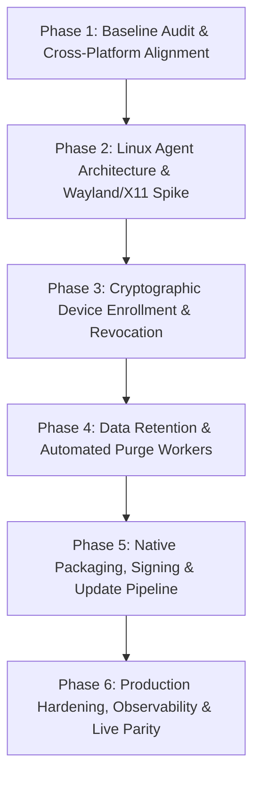

# Dosi-Tracker — PM Execution Plan & Multi-Phase Roadmap

> **Document Class:** Product Management Execution Plan & System Engineering Architecture  
> **Target Release:** Production Multi-Tenant Activity & Time-Tracking Platform  
> **Platforms:** Backend (.NET 10 / ABP / PostgreSQL), Web Dashboard (Next.js 16 / React 19 / Tailwind), Native Desktop Clients (Windows Rust, macOS Swift, Linux Rust/Tauri/Daemon)  
> **Audit & Baseline Date:** October 2026 (Local Baseline Verification Complete)

---

## 1. Executive Summary & Philosophy

Dosi-Tracker is an open-source, multi-tenant team activity and time-tracking system designed to provide transparent, consensual, and privacy-first visibility into work activity. The system consists of:
1. **Cloud Backend**: .NET 10, ABP Framework, Entity Framework Core, PostgreSQL, OpenIddict (OIDC), and ABP Blob Storing (S3/Cloudflare R2/Database).
   - *Test Evidence Distinction*: Backend services are validated using concrete Entity Framework Core SQLite in-memory test host fixtures (`Dosi.Tracker.EntityFrameworkCore.Tests`) and simulated authentication principals. This validates schema constraints, business rules, and unit-of-work logic, but does not represent a live multi-node production deployment.
2. **Web Dashboard**: Next.js 16 (App Router, Turbopack, Tailwind CSS, Recharts) supporting SaaS tenant workflows, manager monitors, real-time analytics, reporting, and platform host administration.
   - *Test Evidence Distinction*: Dashboard modules are validated via component and integration tests in Node.js / jsdom using `@testing-library/react` and synthetic memory datasets. This confirms accessibility, UI state machines, and client calculation math, but does not substitute for live end-to-end WAN sessions.
3. **Native Desktop Clients**:
   - **Windows Client**: Native Rust background agent with egui UI, Win32 hooks (`rdev`), `xcap` GDI/DXGI display capture, MediaFoundation webcam capture, DPAPI credential encryption, and local SQLite offline queue.
     - *Test Evidence Distinction*: 345 cargo tests verify SQLite queue FIFO semantics, backoff math, poison row parking, and synthetic state machines. Native interactive screen grabs, hardware keystroke interrupts, and Win32 focus transitions are implemented in source but are **not** verified interactively during automated unit testing.
   - **macOS Client**: Swift 5.9 native menu-bar application leveraging `ScreenCaptureKit` (`SCScreenshotManager`), `AVFoundation`, `Accessibility` / `CGEvent` APIs, Keychain storage, and SQLite3 offline queue.
     - *Test Evidence Distinction*: Swift source code is present in `clients/macos/`. Source presence is **not** complete runtime validation; CI workflow configuration files are not proof tests ran. Native compilation and runtime validation remain outstanding on this host.
   - **Linux Client**: Explicit architectural greenfield addressing X11 and Wayland display servers (`xdg-desktop-portal` PipeWire screencast, user-space input/window metrics, and graceful degradation reporting).

### Core Privacy & Compliance Invariants
- **Consent-First Architecture & Visible User Controls**:
  - No stealth installation, background evasion, concealed recording, or unauthorized credential sniffing.
  - Data capture requires **per-user opt-in and visible local controls** (system tray / notifications / pause / stop), not merely an administrative project setting on the server.
- **No Privilege Escalation by Default**:
  - The client must never require root, `sudo`, direct `/dev/input/event*` reading via `evdev`, or `uinput` privilege escalation as a default operational mode.
- **No Input Synthesis**:
  - The desktop client is strictly an observer. It must never synthesize mouse movements, inject keystrokes, or simulate fake user presence.
- **Input Counts Only (No Raw Keys or Cadence)**:
  - The agent captures monotonic keyboard and mouse event tallies. Raw keystrokes, clipboard buffers, keycodes, and inter-keystroke timing cadences are **strictly excluded** from data capture and serialization.
- **No Default Hardware Fingerprinting**:
  - Desktop installations are identified by a generated UUIDv4 `DeviceId`. The agent does not collect MAC addresses, BIOS serial numbers, CPU serials, or persistent hardware identifiers by default.
- **Graceful Degradation vs Fabricated Metrics**:
  - On Wayland or restricted environments where global input sniffing or active window tracking is unsupported without root, the client and server must report the metric as **explicitly unavailable** (`null`).
  - The agent must never promise active-window data without an authorized supported interface, and must never emit fabricated zero counts that create a false record of user idleness.
- **Granular Project Policy & Opt-In Webcam**:
  - Capture features (screenshots, webcam, active window, running programs) are configured per-project on the server and enforced on both client and server.
  - Webcam capture defaults to `false`. When enabled, captures require local user consent, visible indicator, and capture only discrete downscaled JPEGs once per interval.
- **Testing Guardrail**:
  - Under no circumstances are live workstation screens, webcams, or employee activities captured during automated testing or QA. All test suites operate strictly on synthetic fixtures, in-memory mocks, and simulated inputs.

---

## 2. Multi-Phase Implementation Roadmap

### Phase 1: Baseline Audit, Toolchain Verification & Cross-Platform Contract (Completed in Current Sprint)
- **Scope**:
  - Full codebase audit across backend, frontend, desktop clients, CI, and test suites.
  - Toolchain verification (.NET 10, Node 24, Rust 1.97, Swift availability check).
  - Identification of platform gaps, stubbed endpoints, and security/privacy debts.
  - Implement the cross-platform contract gap: enable `"linux"` platform normalization in backend (`ActivityConsts.Platforms`), frontend contract (`api-contract.ts`), types (`types.ts`), device monitors (`devices.ts`), reporting maths (`report-math.ts`), live datasets (`live-dataset.ts`), and analytics charts (`analytics-charts.tsx`).
  - Resolve accessibility contrast regression on Linux platform color (`#cb6e17` yielding $\ge 3:1$ on light `#ffffff` and dark `#1a2226` card tokens).
  - Add automated contrast regression test suite and dedicated Linux `platformMix` regression test.
  - Split backend Linux test cases into independent `[Fact]` methods (`Create_Should_Accept_And_Store_Linux_Platform` and `Heartbeat_Should_Accept_And_Store_Linux_Platform`) executed by concrete EF Core host harness (`EfCoreActivityAppServiceTests` and `EfCorePresenceAppServiceTests`).
- **Gating Evidence**: All 823 backend tests green (60 Domain, 116 Host, 166 Application, 466 EntityFrameworkCore, 15 Acceptance); all 1,961 frontend vitest tests green across 92 files; 49 a11y tests green; 12 frontend architecture tests green; Next.js typecheck clean; ESLint clean (0 errors); Windows client 345 cargo tests green.

### Phase 2: Linux Desktop Agent Core & Wayland/X11 Architecture Spike
- **Objective**: Establish the official `clients/linux` component without claiming cross-compilation or using privilege escalation.
- **Deliverables**:
  1. Create `clients/linux` Rust crate sharing domain models and SQLite queue schema with `clients/windows`.
  2. Implement display server detection: detect X11 (`DISPLAY`) vs Wayland (`WAYLAND_DISPLAY`).
  3. X11 Engine: user-space display snapshot (`xcap` / `XShmGetImage`) and active window tracking (`_NET_ACTIVE_WINDOW`).
  4. Wayland Engine: `org.freedesktop.portal.ScreenCast` via D-Bus and PipeWire for consent-based screen capture.
  5. Fallback & Graceful Degradation: When Wayland compositor forbids global input tapping or active-window tracking without root, report capabilities as **explicitly unavailable** (`null`), never as fabricated zero metrics. Do not escalate to root, evdev, or uinput.
  6. SQLite offline queue identical to Windows/macOS with idempotent client activity ID and poison-row parking (`synced = 2`).

### Phase 3: Cryptographic Device Enrollment, Mutual Session Verification & Revocation
- **Objective**: Move beyond self-reported random `DeviceId` GUIDs to a cryptographic device authorization lifecycle.
- **Deliverables**:
  1. Device Key Generation: Desktop agent generates an Ed25519 or ECDSA keypair stored in OS secure vault (Windows DPAPI, macOS Keychain, Linux Secret Service API / libsecret).
  2. Device Registration API: `POST /api/app/devices/register` associating public key, user approval, and authorization grant. No persistent hardware fingerprinting by default.
  3. Device Revocation API: `POST /api/app/devices/{id}/revoke` allowing workspace owners/admins and users to revoke any authorized agent install.
  4. Middleware / Filter: Ingestion endpoints (`/api/app/activity`, `/api/app/presence/heartbeat`) verify device active status; revoked devices receive `403 Tracker:DeviceRevoked` causing agent to pause, purge local auth tokens, and require re-authentication.

### Phase 4: Automated Data Retention, Pruning Workers & Storage Optimization
- **Objective**: Automate data retention policies across PostgreSQL tables and S3/R2 blob containers.
- **Deliverables**:
  1. Background Worker (`DataRetentionWorker` in ABP): Periodic sweep honoring workspace retention settings (e.g. 30, 90, 180, 365 days).
  2. Screenshot Deletion: Purge aged screenshot blobs from object storage and cascade delete `Screenshot` rows.
  3. Activity Compaction: Roll up expired minute-bucket activity into summarized hourly/daily aggregates before archival.
  4. GDPR Erasure Endpoint: Allow user or administrator-initiated erasure of personal biometric/screenshot artifacts.

### Phase 5: Native Packaging, Signed Distribution & Secure Auto-Update Strategy
- **Objective**: Production-grade installers, signed executables, and secure update manifests for all three platforms.
- **Deliverables**:
  1. **Windows**: Authenticode code-signing configuration for NSIS installer (`dosi-tracker-setup.exe`) to eliminate SmartScreen warnings. SmartScreen must not be bypassed in production guidance; code signing is a required production gate.
  2. **macOS**: Integrate Apple Developer ID Application certificate signing, Hardened Runtime entitlements (`com.apple.security.device.camera`, `com.apple.security.files.user-selected.read-write`), and Apple Notarization (`xcrun notarytool submit` + `stapler`). Universal binary (arm64 + x86_64) distribution.
  3. **Linux**: Package as AppImage (portable across distros), `.deb` for Debian/Ubuntu, and `.rpm` for Fedora/RHEL. Provide Flatpak manifest for sandbox compliance.

### Phase 6: Production Infrastructure, Observability & Multi-Region Parity
- **Objective**: Production hosting, automated DR drills, and end-to-end monitoring.
- **Deliverables**:
  1. OpenTelemetry metrics and distributed tracing in HttpApi.Host.
  2. Prometheus metrics exporter for ingest rate, queue latency, and error breakdown.
  3. PostgreSQL backup verification drill (`pg_dump` restore validation runbook).
  4. CDN and presigned URL streaming for screenshot assets.

---

## 3. Platform & Architectural Constraints

| Topic | Constraint | Architecture Decision |
|---|---|---|
| **OS Credentials** | Plaintext tokens or passwords in files are prohibited | Windows: DPAPI `CryptProtectData`. macOS: Keychain Services. Linux: Secret Service API (`libsecret`) / encrypted SQLite key. |
| **Keystrokes** | Privacy regulations (GDPR, CCPA) strictly prohibit key logging | Agents record only atomic integer increments (`keyboard_events += 1`). No virtual key codes or ASCII values are logged or transmitted. |
| **Webcam Security** | Biometric and camera capture requires explicit consent | Webcam captures are stored as discrete JPGs tagged `kind: webcam`. Project settings default to disabled; disabling on server hides historical webcam items from unauthorized roles. Per-user local consent and indicator required. |
| **macOS Permissions** | macOS enforces sandbox and TCC privacy controls | Agent handles missing permissions gracefully: screen capture omitted if Screen Recording denied; input counts omitted if Accessibility denied; camera frame omitted if Camera denied. |
| **Linux Wayland** | Compositor security prevents silent background screen grabs | Ingestion engine requires `xdg-desktop-portal` user consent session. If denied or unavailable, agent logs refusal and records capabilities as unavailable (`null`), without fabricating zeros or attempting privilege escalation. |
| **Offline Idempotency** | Network partitions cause client queue retransmissions | **Database Index**: Unique index `IX_AppActivities_WorkspaceId_UserId_ClientActivityId` on `(WorkspaceId, UserId, ClientActivityId)`. Supported by non-unique index `IX_AppActivities_WorkspaceId_ClientActivityId` for fast cross-member conflict checks (`ActivityClientIdConflict`). Duplicate insert caught and returns existing row with 200 OK. |

---

## 4. Verification & Testing Standards

1. **Backend**:
   - Unit tests: Domain invariants and normalizers (`Domain.Tests`, 60 tests).
   - Integration tests: In-memory SQLite with full ABP Unit of Work, data filters, and tenant isolation (`EntityFrameworkCore.Tests`, 466 tests).
   - Host route tests: HTTP controller status codes and rate limiting (`HttpApi.Host.Tests`, 116 tests).
   - Acceptance tests: Multi-step BDD scenarios (`Acceptance.Tests`, 15 tests).
   - Total backend test count: **823 tests** (all passing).
2. **Frontend**:
   - Unit & Property tests: Business math and data transformations via Vitest and `fast-check` (`src/lib/*.test.ts`).
   - Component & a11y tests: React Testing Library with `jest-axe` for WCAG 2.1 AA compliance (49 a11y tests, machine-contrast regression in `analytics-charts.test.ts`).
   - Architectural gate: `dependency-cruiser` checking layering rules and forbidden circular imports (`test:arch`, 12 tests).
   - Total frontend test count: **1,961 tests** (all passing across 92 files).
3. **Windows Agent**:
   - Crate tests: In-memory SQLite queue FIFO order, upload backoff doubling, poison row parking, session state machines, time math across DST/midnight boundaries (345 cargo tests passing, 5 ignored e2e).
4. **macOS Agent**:
   - Swift Package tests: `DosiTrackerCoreTests` testing models, queue, date parsing, skew calculations, and upload retry logic (source present; local runtime execution unverified on Windows host).
